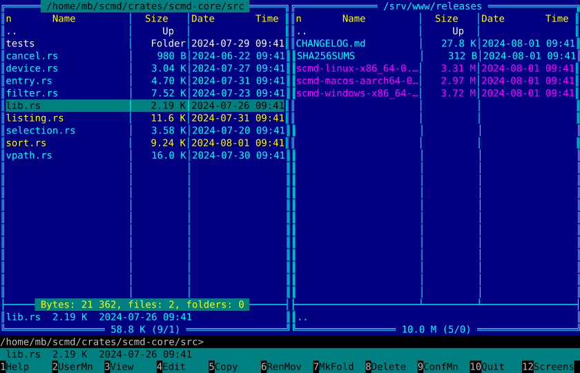
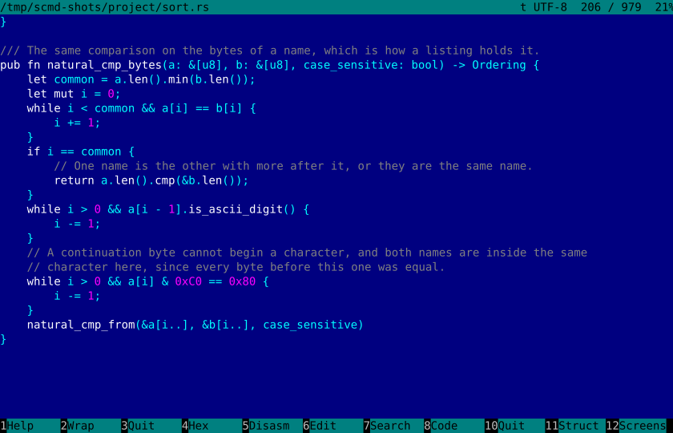
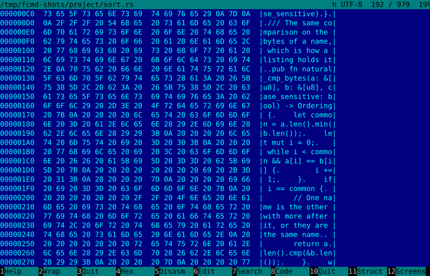
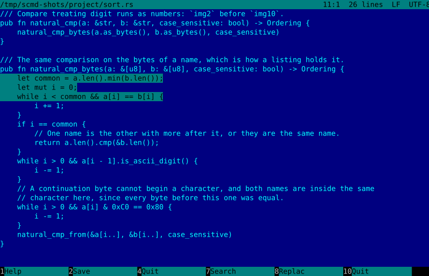
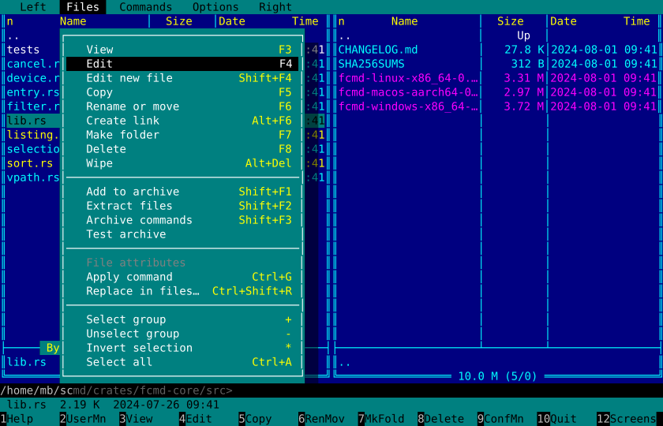
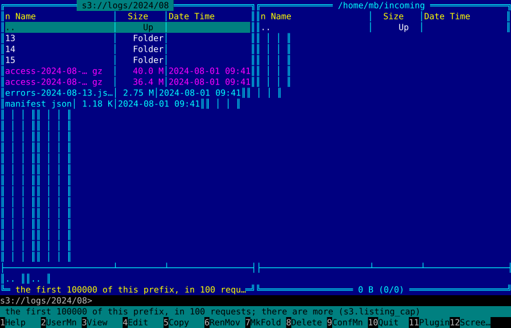
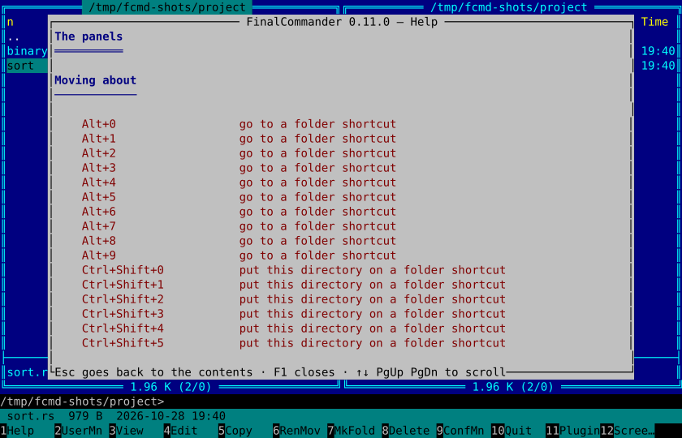

<p align="center">
  
</p>

<h1 align="center">FinalCommander</h1>

<p align="center">
  <b>One file. Every system. Everything in it.</b><br>
  The shape Norton Commander gave the terminal and the keys FAR kept — in a single executable
  you copy onto a machine and use, on Linux, macOS and Windows alike.
</p>

<p align="center">
  <a href="https://github.com/matteobaccan/FinalCommander/actions/workflows/ci.yml"></a>
  <a href="https://github.com/matteobaccan/FinalCommander/releases/latest"></a>
  <a href="https://github.com/matteobaccan/FinalCommander/releases"></a>
  <a href="LICENSE"></a>
  
  
  <a href="https://matteobaccan.github.io/FinalCommander/"></a>
</p>

<p align="center">
  
</p>

## The argument, in one paragraph

You already use a two-panel file manager. Around it you have also collected an archiver, an
SFTP client, something for S3, a hex editor, a viewer that survives a four-gigabyte log, a
grep-across-files tool, an editor that colours code — and a different set of all of those on
the other operating system you work on. **FinalCommander is one binary, about five megabytes
to download, that does all of it with the same keys on all three platforms.** No installer. No
runtime. No DLLs, no asset directory, no plugin tree to assemble: the themes, the keymaps,
seven interface languages, the whole help and the manual page are compiled into the file.
`scp` it to a server and it works there too.

## What the one file replaces

| What you open today | In FinalCommander |
| --- | --- |
| A file manager | Two panels, the selection matrix, FAR's ten view modes, nine sort keys with tie-breakers and sort groups, filters, quick search, and the command line with the shell behind it (`Ctrl+O`) |
| An archiver | `Enter` opens a zip, a 7z or a tarball **as a panel**; `Shift+F1` builds one; `Shift+F2` extracts; `Shift+F3` tests every entry against the format's own checks |
| A client for servers | `sftp://user@host/dir`, `ftp://…`, `ftps://…`, `webdav://…` and `webdavs://…` are panels. Copy between two servers with `F5`; edit a remote file with `F4` and `F2` writes it back |
| `ssh -L` | `8080:db.internal:5432` forwards a port over the connection the panel is already on — no second login, no second terminal |
| An S3 browser | `s3://logs/2024/08/` is a panel, on AWS or on MinIO, Ceph, Garage, R2, Wasabi. A bucket of 1.7 million objects opens as fast as one with ten |
| A pager for huge files | The viewer (`F3`) never loads a file: a 40 GB log opens at once and `End` is one seek. Text, dump, hex, and encodings it detects |
| A hex editor | `F4` on a binary: two panes, a patch list of what changed, block operations (`F12`), and an **assembler** (`F9`) that writes instructions over the bytes |
| A disassembler | x86 and x86-64 with sections and symbols, from ELF, PE and Mach-O; JVM class files and .NET assemblies read in process; search by **instruction pattern** |
| `grep -r` and `sed -i` | Find by mask **and by content** (`Alt+F7`), with the results usable while the walk is still running, and replace across files with the count taken before anything is written |
| `diff -r` | Compare two folders by name, size and time — or by **what is in the files**, which also knows "the same but for the line endings" |
| A code editor | `F4` edits with undo, column blocks, an atomic save, and syntax colouring for twenty-five languages and markups |
| A macro recorder | `Ctrl+.` records *commands*, not keystrokes, and a macro can run once or once for every selected file |
| A calculator | `Alt+=`, in every base at once |

Each of those is a key, not a plugin to go and find.

## Why not the one you already have

Every orthodox commander is the same good idea, implemented once per operating system:

| | Platforms | Shipped as | Licence |
| --- | --- | --- | --- |
| **FAR Manager** | Windows | an installer and a plugin tree | BSD-3-Clause |
| **far2l** | Linux, macOS | build it, or a distribution package | GPL-2.0 |
| **Midnight Commander** | Unix | a distribution package | GPL-3.0 |
| **Total Commander** | Windows | an installer, shareware | proprietary |
| **Double Commander** | Linux, macOS, Windows | a GTK/Qt application | GPL-2.0 |
| **Krusader** | Linux (KDE) | KDE libraries | GPL-2.0 |
| **MTN2** | Windows, Linux | a folder, or a `.deb` | MPL-2.0 |
| **FinalCommander** | **Linux, macOS, Windows** | **one file, copied** | **MIT** |

Learn the keys once and they are the keys everywhere — including on the server you only ever
reach over SSH, where a GTK application is not an option and installing a package may not be
either.

Credit where it is due: FAR with twenty years of plugins goes deeper on Windows than this does
today, Midnight Commander is already on every Unix machine you will ever log into, Krusader's
synchroniser has no equal here yet, and MTN2 — the closest thing to this in spirit — has a real
console in it, which is the one thing a terminal program cannot borrow from a terminal. What
none of them is, is the same program on all three systems, in one file, with nothing to
install — and that is the hole this fills.

> **Status: 0.10.0, and what it wants is ideas.** Everything described above works today, so
> the useful thing to send is not a bug hunt but a *feature*: what you reach for in FAR,
> Midnight Commander, Total Commander or Far-NetBox that is not here, or is here and does
> less. Open an issue and it gets built — that is how most of the last few releases happened.
> What is *not* there says so rather than failing quietly: image previews and plugins loaded
> from disk are not here yet. [`CHANGELOG.md`](CHANGELOG.md) is what has landed and
> [`docs/BACKLOG.md`](docs/BACKLOG.md) is what has not, item by item, with the reason each one
> is still a line.

## What it looks like

Not photographs: every picture here is drawn by the renderer itself, from the same cell buffer
the terminal is given, by `cargo test -p fcmd --bin fcmd write_the_screenshots -- --ignored`.
They cannot show a version of the program that no longer exists.

| | |
| --- | --- |
|  |  |
| **The viewer** (`F3`), in FAR's own colours, with the syntax coloured. | **The hex view** (`F4` in the viewer): offsets, bytes, and the characters beside them. |
|  |  |
| **The editor** (`F4`): a marked block, and the language named in the title bar. | **The menus** (`F9`): each shortcut is read from the keymap in force, and what is not implemented yet is drawn dim and says so when chosen. |
|  |  |
| **A bucket as a panel** (`s3://logs/2024/08/`): the folders are common prefixes the service computes, and the footer says when the listing is not all of it. | **The help** (`F1`): the keys of the screen you are on, each with what it does, generated from the keymap in force. |

## Install

One file, nothing to install beside it. Download the archive for your machine from the
[releases page](https://github.com/matteobaccan/FinalCommander/releases), unpack it, and put
`fcmd` somewhere on your `PATH`.

Up to and including 0.4.0 the program was called SupremeCommander and its command was `scmd`,
which is the name the archives of those releases carry. A configuration from that version keeps
working: every file is read under its new name first and its old one after, and the startup
screen says which one it found.

| Platform | Archive |
| --- | --- |
| Linux (x86-64) | `FinalCommander-linux-x86_64-<version>.tar.gz`, or `FinalCommander-linux-x86_64-static-<version>.tar.gz` for a statically linked build that runs on any distribution |
| macOS (Intel and Apple Silicon) | `FinalCommander-macos-universal-<version>.tar.gz` — one binary for both |
| Windows (x86-64) | `FinalCommander-windows-x86_64-<version>.zip` |

The files sit at the root of the archive, so unpacking leaves `fcmd` where you are rather than
one directory down.

```sh
# Linux, for example
tar xzf FinalCommander-linux-x86_64-0.5.0.tar.gz
sudo install -m755 fcmd /usr/local/bin/fcmd
fcmd --version
```

`SHA256SUMS` beside the archives lets you check what you downloaded:
`sha256sum --check SHA256SUMS`.

macOS will refuse a binary it has not seen before; it is not signed yet, so the first run
needs `xattr -d com.apple.quarantine fcmd` (or Open anyway in System Settings → Privacy).

From source, with Rust 1.89 or newer:

```sh
cargo install --git https://github.com/matteobaccan/FinalCommander fcmd
```

Everything the program keeps on disk is optional and amounts to three things: one settings
file (`fcmd.toml`, which also holds your themes and keymaps), one state file beside it, and
one `plugins/` directory — the only directory it ever reads. Delete them and nothing breaks.

## Try it

```sh
fcmd /etc /tmp     # left panel, right panel
```

<p align="center">
  
</p>

Two files marked, the cursor on a third, the totals under each panel, and the key bar along
the bottom — drawn by the renderer itself, as every picture here is.

Hold `Shift` and the key bar becomes the archive keys; hold `Ctrl` and it becomes the sort
keys; hold `Alt` and it becomes the drives, the search and the histories. `F1` tells you what
every key on the screen you are looking at does.

## What works today

- **File operations**: `F5` copy, `F6` move/rename, `F7` create directory, `F8` delete — on the
  selection or on the item under the cursor, with the destination prefilled from the passive
  panel. Recursive trees, conflict dialogs (overwrite / all / skip / skip all / cancel), error
  decision points (retry / skip / skip all / cancel), a progress overlay with a per-file and a
  total bar, `Esc` to cancel, and both panels refreshed afterwards. A same-filesystem move is a
  rename, not a copy. A copy is written to `name.fcmd-part` and renamed only when complete, so
  an interrupted operation never leaves a file that looks finished. `F8` hands what you chose
  to the system's own wastebasket — the one your desktop's file manager shows — and `Shift+Del`
  deletes outright. Checksums (MD5, SHA-1, SHA-256) are written in the format `sha256sum`
  reads, and a list can be checked back against the files beside it. `Ctrl+Shift+Y`
  synchronises two directories through a table you can edit before anything is written.
- **Panels**: `Tab` / `Ctrl+U`, arrows / `PgUp` / `PgDn` / `Home` / `End` / `Enter` /
  `Ctrl+PgUp` / `Backspace` / `Ctrl+\` with history (`Alt+←/→`), `Ins` and `+` / `-` / `*`
  selection by mask, `Ctrl+F3..F11` sorting — all nine of FAR's keys, down to the description
  and the owner — with a chain of tie-breakers, `Shift+F11` sort groups, `Ctrl+1..0` view
  modes, all ten of FAR's, `Ctrl+H` hidden files, `Ctrl+Shift+I` live filter, quick search by
  typing (`Alt+<letter>`), `Space` for a recursive directory size, `Ctrl+=` to sync the other
  panel, `Ctrl` with the arrows to reshape the two panels, and the panels FAR has: quick view
  (`Ctrl+Q`), info (`Ctrl+L`), tree (`Ctrl+T`).
  A panel holds more than one directory at a time: `Ctrl+Alt+T` opens a tab, `Ctrl+Alt+N` and
  `Ctrl+Alt+P` step along the row, `Ctrl+Alt+M` hands one to the other panel, `Ctrl+Alt+K`
  locks one to its directory, and the row comes back with its names between sessions.
  Folders are kept to hand on ten digits — `Ctrl+Shift+0..9` to set one, `Alt+0..9` to go —
  with `Ctrl+D` for the whole named hotlist. A directory's own `descript.ion` is read, shown
  (`Ctrl+6`, `Ctrl+7`) and written (`Ctrl+Z`), and a description follows its file through a
  copy, a move, a rename and a delete.
- **Panels that are not directories**: `Alt+F1` and `Alt+F2` open the change-drive dialog —
  everything mounted, with what each volume is, what it is called and what is left on it — and
  under it the things that are not filesystems: the stored connections, the object stores, the
  **processes** (`F3` on one is its card: command line, memory, threads, parent, the user it
  runs as), the **sockets** that are listening or connected with the process behind each one,
  the **programs installed** on the machine (`F3` for the card, and its uninstall command put
  on the command line for you to read before you run it), and a temporary panel of files
  gathered by hand from anywhere.
- **Comparison**: the two panels side by side by name, size and time, or by what is actually in
  the files — with "the same but for the line endings", a first-N-kilobyte fragment for big
  files, and the whole thing recursive through the subdirectories, the differences coming back
  as a panel of marked rows rather than a dialog to dismiss. Duplicates in a tree are found by
  content, so two names that are one file show up however differently they are named.
- **Viewer** (`F3`): text, dump and hex on files of any size — position is a byte offset, so
  opening a 40 GB log costs one read and `End` costs one seek. Encoding detected (UTF-8,
  UTF-16 with or without a BOM, CP1252, CP437) and switchable with `F8`; `F2` cycles
  no-wrap / character / word wrap; `F4` between text and hex; `F7` opens one search dialog that
  asks the whole question — text, hex or a regular expression, case, whole words, forwards or
  backwards. A structure pane (`F11`) for binaries, with sections and symbols, and `F5` to read
  the bytes as instructions.
- **Editor** (`F4`): undo over the session, column blocks, search and replace, an atomic save,
  and syntax colouring for Rust, C, C++, Java, C#, JavaScript, TypeScript, PHP, Python, Ruby,
  Go, shell, SQL, HTML, XML, CSS, Markdown, JSON, TOML, YAML, INI, Make, Dockerfile, Lua and
  Perl. On a binary it is a hex editor instead, with a patch list and an assembler.
- **Archives**: zip, 7z and the tar family (plain, gzip, bzip2, xz, zstd), all with pure-Rust
  decoders — nothing shells out, and no `7z.dll`. `Enter` opens one as a panel, `F3` reads an
  entry, `F5` copies out through the same job engine as any other copy.
- **Servers and buckets**: SFTP, FTP, FTPS and WebDAV panels and transfers, a session editor,
  host-key checking against `known_hosts`, port forwarding, and `s3://` panels with the credentials read
  from the environment or `~/.aws/credentials` — never written into the configuration file.
- **The program itself**: six themes, seven interface languages switchable while it runs, two
  keymap profiles (FAR and mc) and your own on top, macros, the screens list (`F12`), plugin
  commands (`F11`), a help system whose key pages are generated from the keymap in force, and a
  manual page.

Non-interactive modes, for CI and for scripts:

```sh
fcmd --list-themes      # built-in and external themes, with where each came from
fcmd --list-commands    # the command vocabulary every key, menu and plugin binds to
fcmd --list-languages   # en it de fr es ru zh
fcmd --check-keymap     # validate a keymap and print the resolved bindings
fcmd --dump-config      # the effective configuration
fcmd --export-theme tron >> ~/.config/fcmd.toml   # a ready-to-paste [[theme]] block
fcmd --paths            # where the config file, the state file and plugins/ are
fcmd --list-plugins     # what is in the plugins directory
```

## Coming from another commander

`ui.keymap = "far"` is the default and `"mc"` ships beside it; a keymap of your own is a TOML
file of `keys = [...]` / `cmd = "..."` lines, and `fcmd --check-keymap` tells you whether it
resolves before you rely on it. Every action in the program is a named command —
`fcmd --list-commands` prints all of them — so anything you can reach with a key you can also
put in a menu, a macro or a plugin.

## Why the command is `fcmd`

`fc`, the obvious short form of the name, is taken twice: `fc.exe` in Windows' `System32` is
the file-compare tool, and on Unix `fc` is a shell builtin that re-runs the last command — a
commander that promises the same keys on three platforms cannot fight a system command for its
own name. `fcmd` is free everywhere, it is what the archives, the configuration file and the
crates are all called, and it is four letters. Please do not "fix" it to something shorter.

## Themes and languages

Six themes are compiled in — `commander` (the classic blue, default), `black`, `white`,
`matrix`, `tron`, `blade` — and `[[theme]]` blocks in `fcmd.toml` are read at startup,
hot-reloaded, may `inherit` a built-in one, and replace a built-in with the same id.

The interface ships in English, Italian, German, French, Spanish, Russian and Simplified
Chinese (`ui.language = "auto"` follows the OS locale); CJK double-width layout is tested.
`F9` → Options → Languages switches language while the program runs, and Options → Themes is
the same list for the themes; `Shift+F9` makes either choice permanent.

## How it is built

A strictly TUI interface — it works over SSH and in tmux — and there is no GUI build and will
not be one: the graphical commanders are a crowded field, and the open slot is a terminal
commander with a modern engine underneath.

```
crates/fcmd-core     paths, entries, listings, sorting, selection   (no dependencies of ours)
crates/fcmd-vfs      the Vfs trait + the local provider
crates/fcmd-jobs     the operation engine: plan, execute, settle; conflicts and progress
crates/fcmd-arc      archives: zip, 7z and the tar family, reading, writing and testing
crates/fcmd-view     the viewer: windowed reads, encodings, text/dump/hex, search, disasm
crates/fcmd-edit     the editor: buffer, undo, blocks, search/replace, atomic save
crates/fcmd-syntax   the syntax scanner: one line, and the state the line before it left
crates/fcmd-net      netbox: SFTP, FTP/FTPS and WebDAV, sites, pool, tunnels, routed jobs
crates/fcmd-s3       object storage: SigV4, listings, the S3 provider and a fake service
crates/fcmd-find     find by name and by content, as a walk the interface reads as it runs
crates/fcmd-cmd      command vocabulary, keys, keymap profiles (far, mc)
crates/fcmd-config   TOML configuration, discovery, overrides
crates/fcmd-i18n     fluent catalogues for seven languages
crates/fcmd-plug     the plugin tier: manifests, discovery, running a command
crates/fcmd-ui       cell buffer, colours, themes, panel and chrome widgets
crates/fcmd-tui      the terminal backend: input decoding and diffed painting
crates/fcmd          the binary: CLI, state machine, event loop
crates/fcmd-site     the generator for the project's site: the repository's own documents
```

The last one is not part of the program — `fcmd` does not link it, and a release does not
build it. It reads this file, the changelog, the commander survey, the help chapters in
`docs/help/` and the screenshots in `docs/shots/`, and writes the static site published at
<https://matteobaccan.github.io/FinalCommander/> — 38 pages, no framework, no fonts or
scripts fetched from anywhere, in the seven languages the interface speaks. `cargo run -p
fcmd-site -- --out site` writes it locally, and the workflow builds it on every push and keeps
it as the run's artifact. Nothing publishes by itself: a site on GitHub Pages is public to
everyone, so it goes up only when somebody starts the workflow by hand and says so. The point
of generating it is that a page cannot say something the document it came from does not: there
is no second copy of the text to keep in step.

Every push builds and tests on Linux, macOS and Windows, with `clippy -D warnings`, a licence
check over every crate in the tree on every platform, and a release that cannot be tagged
unless all of that is green.

## Documents

| Document | Content |
| --- | --- |
| [`docs/00-landscape.md`](docs/00-landscape.md) | survey of ~50 commanders: language, licence, what we take from each |
| [`docs/01-licensing.md`](docs/01-licensing.md) | **can we rewrite FAR? yes** — licence analysis (FAR is BSD-3-Clause), what we may and may not reuse, clean-room rules |
| [`docs/02-features.md`](docs/02-features.md) | the complete feature inventory (11 areas, ~130 features) with target milestones |
| [`docs/03-keymap.md`](docs/03-keymap.md) | every key of FAR / mc / Total Commander / Krusader side by side, our default keymap, the command vocabulary, and the terminal limitations that shape it |
| [`docs/04-far-inventory.md`](docs/04-far-inventory.md) | FAR 3.x read from its own repository — 283 help topics, 311 settings keys, the column, mask and metasymbol grammars — with every feature marked against what we do today |
| [`docs/spec/00-overview.md`](docs/spec/00-overview.md) | goals, non-goals, interaction contract, quality gates |
| [`docs/spec/01-architecture.md`](docs/spec/01-architecture.md) | crate layout, threading, rendering, paths, errors, testing |
| [`docs/spec/02-panels.md`](docs/spec/02-panels.md) | panel state, listing, view modes, sorting, filters, tabs, layout |
| [`docs/spec/03-file-operations.md`](docs/spec/03-file-operations.md) | job engine, conflicts, copy semantics, queue, multi-rename, compare/sync |
| [`docs/spec/04-vfs.md`](docs/spec/04-vfs.md) | the `Vfs` trait, capabilities, providers (archives, SFTP, S3, …), nesting |
| [`docs/spec/05-viewer-editor.md`](docs/spec/05-viewer-editor.md) | viewer (text/hex/dump/preview), editor (column blocks, undo, syntax), diff |
| [`docs/spec/06-tools.md`](docs/spec/06-tools.md) | find, grep, disk usage, user menu, associations, shell/PTY integration, help |
| [`docs/spec/07-config-theming.md`](docs/spec/07-config-theming.md) | TOML config, keymap profiles, themes, i18n, config import from other commanders |
| [`docs/spec/08-plugins.md`](docs/spec/08-plugins.md) | command bus, Lua API, WASM plugin ABI (WIT), native ABI, macros |
| [`docs/spec/09-roadmap.md`](docs/spec/09-roadmap.md) | M1→M4 with issue-sized chunks, risks, contribution rules |
| [`docs/spec/10-menus-and-dialogs.md`](docs/spec/10-menus-and-dialogs.md) | the menu bar, the settings dialogs and the choose-one lists, with every row mapped to a config key |
| [`docs/BACKLOG.md`](docs/BACKLOG.md) | what is specified but not built yet, and the decisions still open |

## Asking for something: issues, not pull requests

**Please do not open a pull request with new code.** Open an **issue** and say what the
program does not do yet, or what it does wrong — [*Something is
missing*](https://github.com/matteobaccan/FinalCommander/issues/new?template=missing.yml) and
[*A bug*](https://github.com/matteobaccan/FinalCommander/issues/new?template=bug.yml) are the
two forms, and they ask for exactly what is needed to act on them. **We will build it for
you**, and the issue is where you will see it land, with the release it landed in.

Why it is that way round, plainly:

- Every feature here arrives as a whole: its section of the spec, its chapter of the help, its
  entry in the changelog, its tests on three platforms, and its strings in seven languages. A
  patch that changes the code alone is the smallest part of that work, and finishing it costs
  more than writing it from a good issue would.
- The licensing is a minefield and only the maintainer can walk it. far2l, Midnight Commander,
  Krusader and Double Commander are GPL; this program is MIT; code that arrives in a pull
  request cannot be unseen afterwards. An issue that *describes* a behaviour — "FAR does this,
  it is called that, here is what it looks like" — carries no such risk and is just as useful.
- One voice. The prose in this repository, comments included, is written to be read by someone
  who was not there, and a feature that reads differently from the rest is a feature that will
  be rewritten.

What is always welcome, and needs no code: **a bug report** with what you did, what happened
and what you expected, plus `fcmd --version` and your platform. **A missing feature**, with
the program you know it from and what it is called there — `docs/BACKLOG.md` is worth a look
first, because much of it is already a line there with the reason it is still a line. **A
keymap or a theme**, which are TOML rather than code and can be pasted straight into an issue
(`fcmd --export-theme <id>` prints one to start from). **A translation**, in the same way: the
seven catalogues are `crates/fcmd-i18n/i18n/<lang>/fc.ftl`, and a corrected message is a line
in an issue.

[`CONTRIBUTING.md`](CONTRIBUTING.md) says the same thing at length, with the ground rules.

## Licence question, short version

- **FAR Manager is BSD-3-Clause** → we may study it, port parts of it (with its notice), and
  build a permissively licensed Rust commander on its model. The only restriction that bites is
  the no-endorsement clause: we must not use the authors' names to promote this project.
- **far2l, Midnight Commander, Krusader, Double Commander are GPL** → behavioural reference
  only, never copy or translate their code into this project.
- **Total Commander is proprietary** → no code, no resources, no decompiling. Its *key layout
  and feature set* are ideas and interfaces, not protected expression (CJEU C-406/10,
  Lotus v Borland, Google v Oracle), so a `tc` keymap profile is fine.

**This project is MIT licensed** (see [`LICENSE`](LICENSE)); details and the inbound-compatibility
rules in [`docs/01-licensing.md`](docs/01-licensing.md).

## Non-goals

No telemetry, no accounts, no cloud service, no bundled proprietary blobs, no GTK/Qt dependency
in the core, and no attempt to be an Explorer/Finder replacement.

## The pictures

`docs/shots/` holds the screenshots, and they are not screenshots: `write_the_screenshots`
renders the real panels into a cell buffer and writes that buffer as SVG, so regenerating them
is one command and they cannot drift from the program. `crates/fcmd-ui/src/svg.rs` is the
twenty lines that turn a buffer into a picture.

`assets/` holds the logo, the banner and the icon, all in FAR's own palette and all drawn as
SVG — `assets/README.md` says what each is for and how the PNGs and the `.ico` are made from
them. The banner is sized for the repository's social preview (Settings → Social preview takes
`assets/banner.png`).

<p align="center">
  
</p>

---

Documents are written in English so the project is contributable; discussion happens in
English and Italian.
