<p align="center">
  
</p>

<h1 align="center">FinalCommander</h1>

<p align="center">
  <b>You wanted one commander for every operating system. The most complete there is. One that
  talks to AI. With every plugin already inside.<br>
  Now it exists. It is FinalCommander — and it is time to uninstall all the others.</b>
</p>

<p align="center">
  <a href="https://github.com/matteobaccan/FinalCommander/actions/workflows/ci.yml"></a>
  <a href="https://github.com/matteobaccan/FinalCommander/releases/latest"></a>
  <a href="https://github.com/matteobaccan/FinalCommander/releases"></a>
  <a href="LICENSE"></a>
  
  
  <a href="https://matteobaccan.github.io/FinalCommander/"></a>
</p>

<p align="center">
  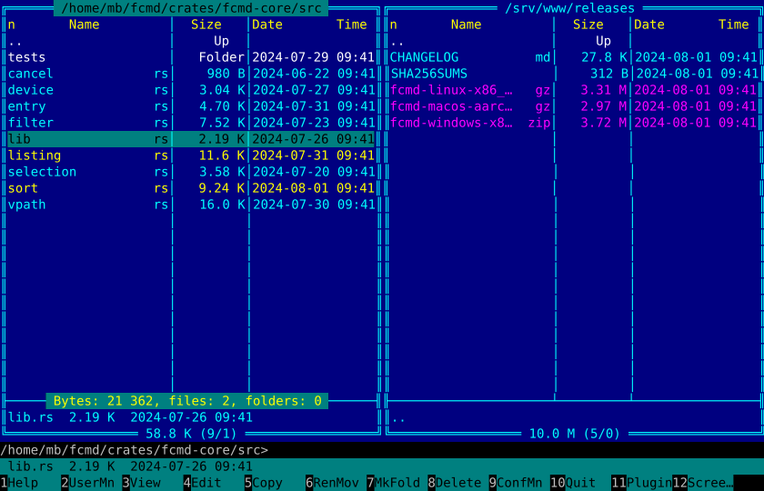
</p>

## The argument, in one paragraph

You use a two-panel file manager — and around it an archiver, an SFTP client, something for
S3, a hex editor, a viewer that survives a four-gigabyte log, a database browser, a mail
reader, a git front end, a chat window for your AI, and a *different* set of all of them on
the other operating system you work on. **FinalCommander is one binary that does all of it,
with the same keys, on Linux, macOS and Windows.** No installer, no runtime, no DLLs, no
plugin tree to assemble: themes, keymaps, seven languages, the whole help and the manual are
inside the file. `scp` it to a server and it works there too.

## Ten reasons to switch today

1. **One program on every system.** Linux, macOS, Windows, and the server you only reach over
   SSH: the same binary, the same keys, the same settings file. Learn it once.
2. **Nothing to install.** One file. Copy it, run it. No package manager, no admin rights, no
   GTK, no Qt, no .NET.
3. **The plugins are already in it.** FAR's NetBox, MultiArc, FindDup, SQLiteDB, FarMail,
   AdvCmpEx, the process list, the services, the uninstaller, the character map, the system
   log, the calculator: built in, tested together, upgraded together. Nothing to hunt for,
   nothing that breaks on the next release.
4. **AI where your files are.** `ai: why does this fail?` with the log selected: the answer
   opens in the viewer and stays in a folder of answers. OpenAI, Anthropic, any compatible
   server, or Ollama on your own machine — and nothing leaves without a dialog saying what.
5. **Every server is a panel.** SFTP (and SSH boxes with no SFTP at all), FTP, FTPS, WebDAV,
   S3 and its clones, IMAP mailboxes, jump hosts, port tunnels, a speed limit per server.
   `F5` between two servers is just a copy.
6. **Every container is a folder.** zip, 7z, tar in all its compressions, deb, rpm, cpio, iso
   and rar through the 7z you have, SQLite databases, JSON files, mbox and eml mail: `Enter`
   goes inside, `F3` reads, `F5` copies out.
7. **A viewer and an editor that do not give up.** A 40 GB log opens at once and follows its
   own growth; hex, disassembly of x86, ARM, JVM and .NET; an editor with syntax colouring,
   column blocks, `.editorconfig`, kept replacements and an atomic save.
8. **Safe by default.** A copy resumes where it stopped and can verify itself by SHA-256; a
   file too big for the target is refused before it starts; a share that does not answer does
   not freeze the screen; the jobs queue per device.
9. **FAR's keys, FAR's look.** If your fingers know FAR, they already know FinalCommander —
   and Midnight Commander's keymap is one setting away.
10. **Free, MIT, and moving fast.** A release almost every day, each one driven by what people
    ask for in the issues.

## What the one file replaces

| What you open today | In FinalCommander |
| --- | --- |
| A file manager | Two panels, the selection matrix, FAR's ten view modes, nine sort keys with tie-breakers and sort groups, filters, quick search, and the command line with the shell behind it (`Ctrl+O`) |
| An archiver | `Enter` opens a zip, a 7z, a tarball, a `.deb` or an `.rpm` **as a panel**, and a `.rar`, an `.iso`, a `.cab` or a `.wim` through the `7z` already on the machine; `Shift+F1` builds one; `Shift+F2` extracts; `Shift+F3` tests every entry against the format's own checks |
| A client for servers | `sftp://user@host/dir`, `ftp://…`, `ftps://…`, `webdav://…` and `webdavs://…` are panels. Copy between two servers with `F5`; edit a remote file with `F4` and `F2` writes it back |
| `ssh -L` | `8080:db.internal:5432` forwards a port over the connection the panel is already on — no second login, no second terminal |
| An S3 browser | `s3://logs/2024/08/` is a panel, on AWS or on MinIO, Ceph, Garage, R2, Wasabi. A bucket of 1.7 million objects opens as fast as one with ten |
| A pager for huge files | The viewer (`F3`) never loads a file: a 40 GB log opens at once and `End` is one seek. Text, dump, hex, and encodings it detects |
| A hex editor | `F4` on a binary: two panes, a patch list of what changed, block operations (`F12`), and an **assembler** (`F9`) that writes instructions over the bytes |
| A disassembler | x86, x86-64 and AArch64 with sections and symbols, from ELF, PE and Mach-O; JVM class files and .NET assemblies read in process; search by **instruction pattern** |
| `grep -r` and `sed -i` | Find by mask **and by content** (`Alt+F7`), with the results usable while the walk is still running, and replace across files with the count taken before anything is written |
| `diff -r` | Compare two folders by name, size and time — or by **what is in the files**, which also knows "the same but for the line endings" |
| A code editor | `F4` edits with undo, column blocks, an atomic save, and syntax colouring for twenty-five languages and markups |
| A macro recorder | `Ctrl+.` records *commands*, not keystrokes, and a macro can run once or once for every selected file |
| A calculator | `Alt+=`, in every base at once |
| A chat window for your AI | `ai: question` on the command line, with the selected files attached after a dialog says what goes where; the answer opens in the viewer and is kept as Markdown |
| A database browser | `Enter` on a SQLite file: every table is a CSV beside the schema, `sql: SELECT …` opens the rows as a table |
| A mail reader | an `.mbox` or `.eml` is a folder of messages and attachments; `imaps://me@host/` is your mailbox, read only |
| A git front end | `Ctrl+Alt+G`: what changed as a panel, the log and the blame in the viewer, the branches |
| A duplicate finder | *Commands → Find duplicate files*: groups by content, every copy but the oldest selected for `F8` |

Each of those is a key, not a plugin to go and find.

## Why not the one you already have

Every orthodox commander is the same good idea, implemented once per operating system — and
each one leaves you a gap to fill with something else:

| | Platforms | Shipped as | Servers built in | AI | Licence |
| --- | --- | --- | --- | --- | --- |
| **FAR Manager** | Windows | an installer and a plugin tree | with plugins | no | BSD-3-Clause |
| **far2l** | Linux, macOS | build it, or a distribution package | with plugins | no | GPL-2.0 |
| **Midnight Commander** | Unix | a distribution package | SFTP, FTP, shell | no | GPL-3.0 |
| **Total Commander** | Windows | an installer, shareware | with plugins | no | proprietary |
| **Double Commander** | Linux, macOS, Windows | a GTK/Qt application | with plugins | no | GPL-2.0 |
| **Krusader** | Linux (KDE) | KDE libraries | through KIO | no | GPL-2.0 |
| **MTN2** | Windows, Linux | a folder, or a `.deb` | some | no | MPL-2.0 |
| **FinalCommander** | **Linux, macOS, Windows** | **one file, copied** | **SFTP, SSH shell, FTP/FTPS, WebDAV, S3, IMAP** | **yes** | **MIT** |

If you are on FAR, you lose nothing of the keys and gain the other two systems. If you are on
Midnight Commander, you gain archives, buckets, databases and a hex editor that are not a
plugin away. If you are on Total Commander, you gain a terminal program you can take onto any
server. Whoever you are, you uninstall the archiver, the SFTP client, the bucket browser, the
hex editor and the database viewer you kept beside it.

> **I do not need your code. I need your ideas.** Everything described above works today, so
> the useful thing to send is not a patch but a *feature*: what you reach for in FAR, Midnight
> Commander, Total Commander or Far-NetBox that is not here, or is here and does less. **Open
> an issue with your idea and it goes into the next release** — that is how most of the
> releases so far happened. Please do not open a pull request with new code; the reasons are
> further down, and at length in [`CONTRIBUTING.md`](CONTRIBUTING.md).
>
> The release badge above is the version, so this line does not have to be a second copy of
> it. What is *not* there says so rather than failing quietly — plugins loaded from disk are
> the large one. [`CHANGELOG.md`](CHANGELOG.md) is what has landed and
> [`docs/BACKLOG.md`](docs/BACKLOG.md) is what has not, item by item, with the reason each one
> is still a line.

## What it looks like

Not photographs: every picture here is drawn by the renderer itself, from the same cell buffer
the terminal is given, by `cargo test -p fcmd --bin fcmd write_the_screenshots -- --ignored`.
They cannot show a version of the program that no longer exists.

| | |
| --- | --- |
| 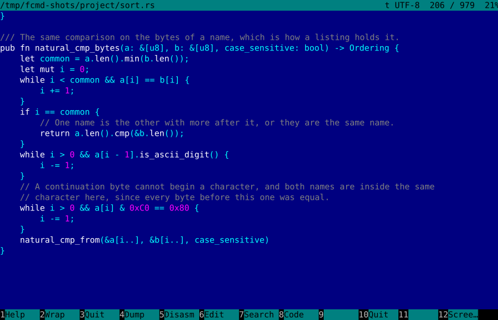 | 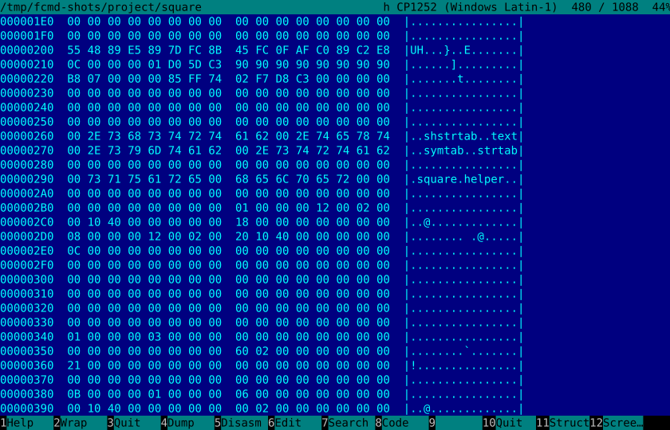 |
| **The viewer** (`F3`), in FAR's own colours, with the syntax coloured. | **The hex view** (`F4` in the viewer): offsets, bytes, and the characters beside them. |
| 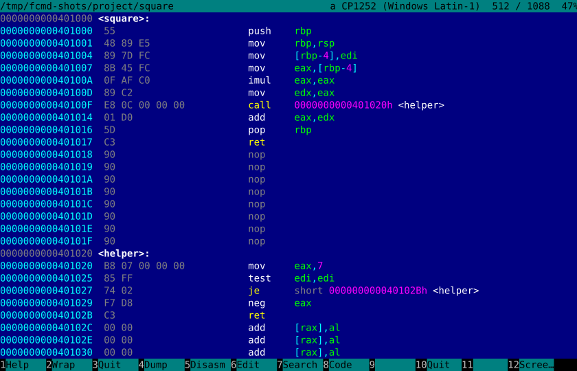 | 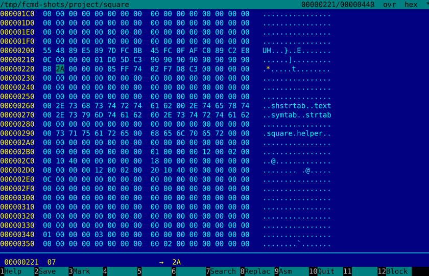 |
| **The disassembler** (`F5` in the viewer): x86-64 in process, each function under its own name, and a call showing where it goes. | **The hex editor** (`F4` on a binary, `Alt+H` in the editor): one byte of `helper` changed from 7 to 42, in its own colour until it is saved, with the old and new value at the bottom. |
| 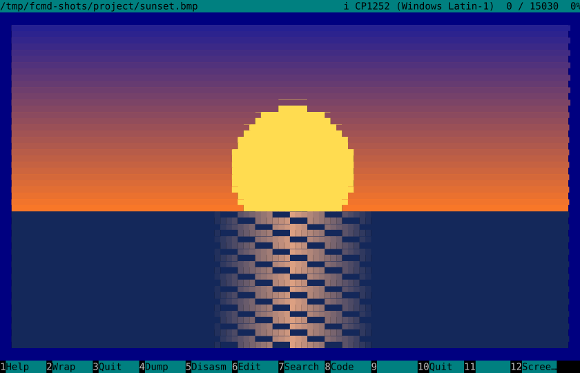 | 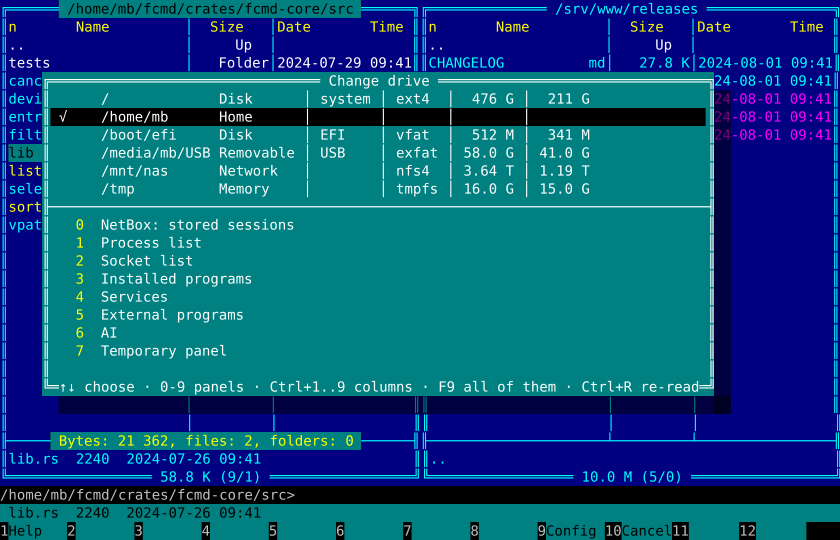 |
| **A picture** (`F3` on a BMP, PNG, JPEG or GIF): two pixels per character cell in half blocks, so it works in any terminal. | **Change drive** (`Alt+F1`): what each one is, its label, its filesystem, its size and what is free, and the plugin panels under them. |
| 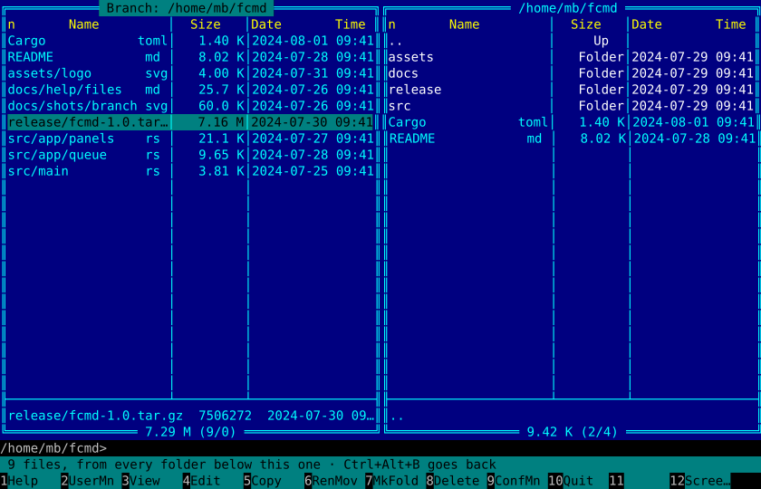 | 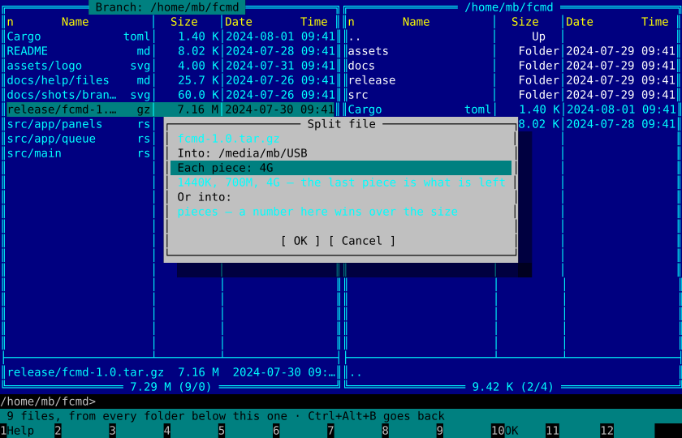 |
| **The branch view** (`Ctrl+Alt+B`): every file below the folder in one flat list, each named by its path from there; copy, delete and the rest work on it as on any panel. | **Split file** (`Files` menu): pieces of a size written as `1440K`, `700M` or `4G`, numbered `.001`, `.002`… with a `.crc` beside them that `Combine` checks the result against. |
| 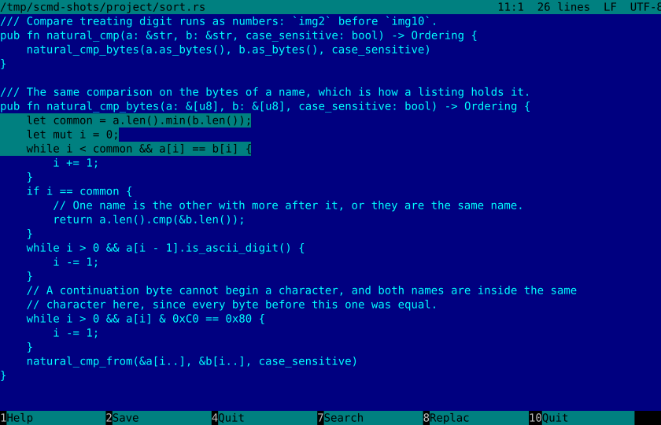 | 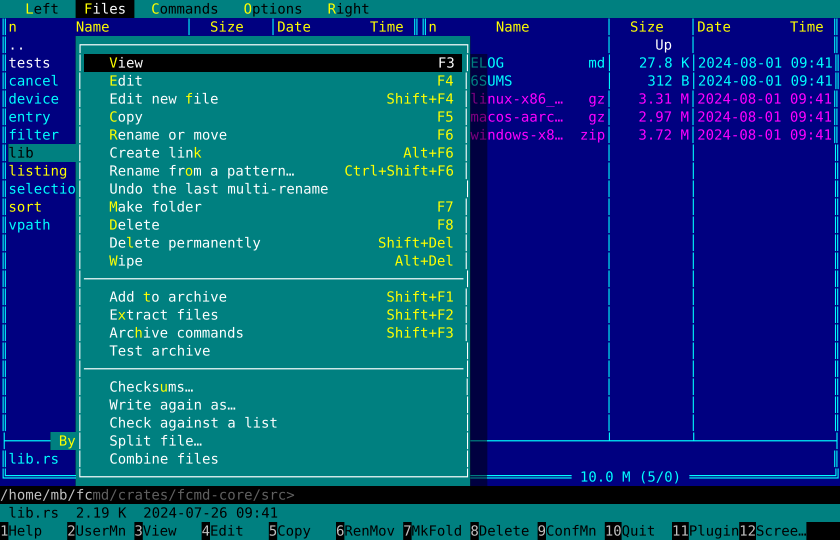 |
| **The editor** (`F4`): a marked block, and the language named in the title bar. | **The menus** (`F9`): each shortcut is read from the keymap in force, and what is not implemented yet is drawn dim and says so when chosen. |
| 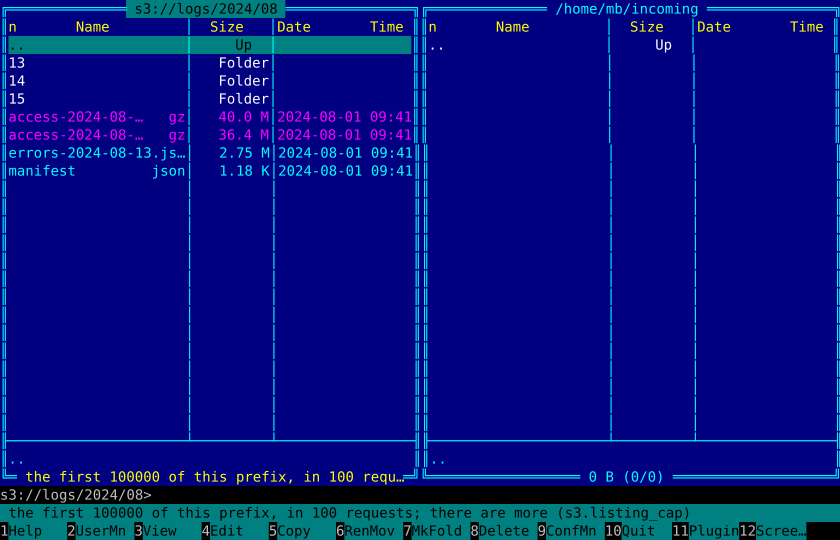 | 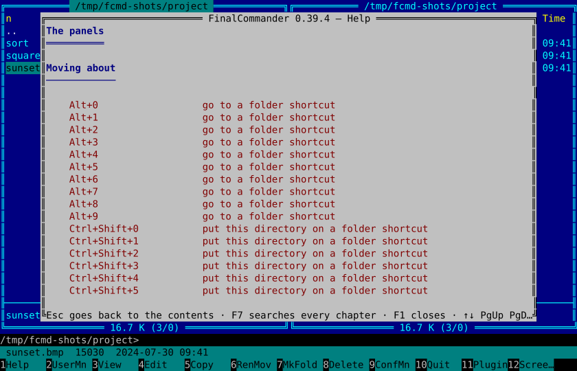 |
| **A bucket as a panel** (`s3://logs/2024/08/`): the folders are common prefixes the service computes, and the footer says when the listing is not all of it. | **The help** (`F1`): the keys of the screen you are on, each with what it does, generated from the keymap in force. |
| 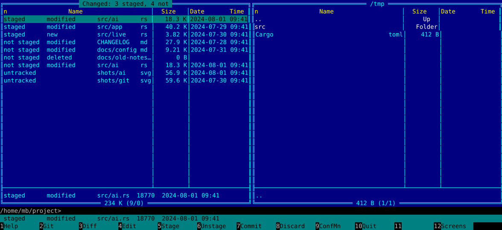 | 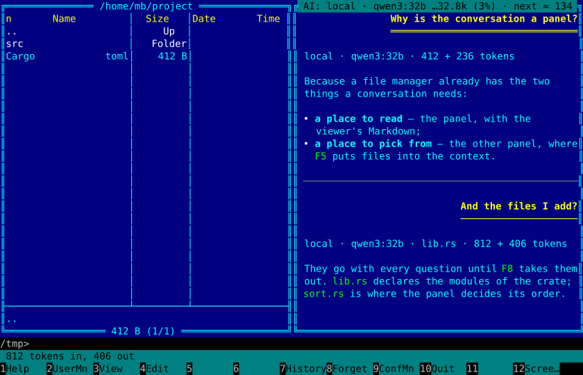 |
| **Git in a panel** (`Alt+F1` → *Git*): what changed, staged apart from not staged, in words; `F5` stages, `F6` unstages, `F7` commits, `F8` discards, `F3` is the side-by-side diff. | **The AI panel** (`Alt+F1` → *AI*): the conversation itself, in Markdown, questions on the right and answers as they are written; the frame names the model and how full its context window is. |
| 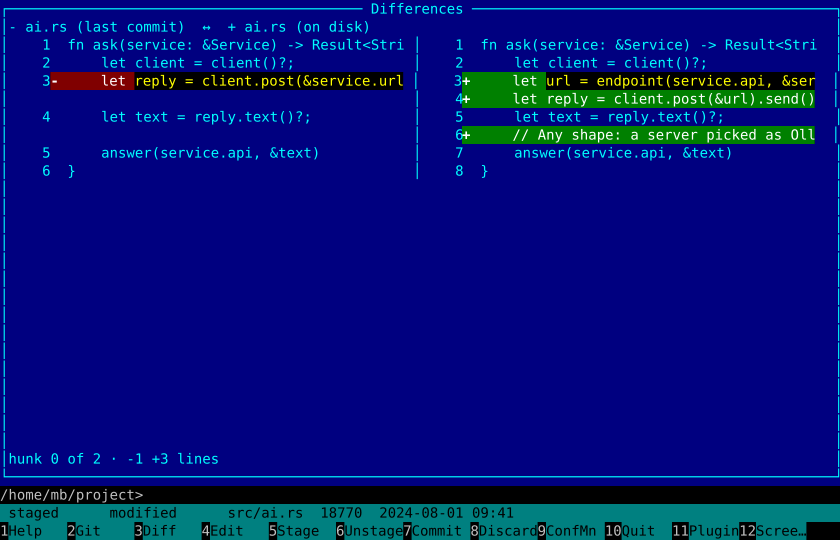 | |
| **The side-by-side diff** (`Ctrl+Shift+D`, or `F3` in the git panel): a line that went is painted red, a line that came green, and the part of a changed line that differs is marked. | |

## Git and AI, each in a panel

**Git.** `Alt+F1` / `Alt+F2` has a *Git* row whenever the panel's folder is in a repository.
It opens *what changed*: every file with its part spelled out — staged, not staged,
untracked, conflict — and what happened to it, a file staged and then changed again being a
row in each part. `F5` stages, `F6` unstages, `F7` commits, `F8` discards after asking (back
to the index, back to the last commit, or to the wastebasket for a file git does not know),
and `F3` shows the two versions side by side, the lines that went painted red and the ones
that came painted green. `Ctrl+Q` beside it is the diff of the row under the cursor. The
`F2` menu turns the list into a tree of folders, and from there the log and the branches are
panels too: `F4` on a commit is what it changed, `F5` pulls, `F6` pushes.

**AI.** The same dialog has an *AI* row: your services — OpenAI, Anthropic, Ollama, or any
server that speaks one of them, local or remote — as a panel. `Enter` logs in by asking the
service for its models, which proves the address and the key without spending a token, and
says how it answered. From then on the panel is the **conversation**: what you type on the
command line is the next question, `F5` in the other panel puts files into its context, and
the panel shows it all as it happens, rendered as Markdown — the questions on the right, the
answer on the left as the model writes it, a turning wheel and the seconds while it thinks.
The frame names the model that answered and how full its context window is. Nothing is sent
without a dialog saying which files and to which host.

## Install

One file, nothing to install beside it. Download the archive for your machine from the
[releases page](https://github.com/matteobaccan/FinalCommander/releases), unpack it, and put
`fcmd` somewhere on your `PATH`.

| Platform | Archive |
| --- | --- |
| Linux (x86-64) | `FinalCommander-linux-x86_64-<version>.tar.gz`, or `FinalCommander-linux-x86_64-static-<version>.tar.gz` for a statically linked build that runs on any distribution |
| macOS (Intel and Apple Silicon) | `FinalCommander-macos-universal-<version>.tar.gz` — one binary for both |
| Windows (x86-64) | `FinalCommander-windows-x86_64-<version>.zip` |

The files sit at the root of the archive, so unpacking leaves `fcmd` where you are rather than
one directory down.

```sh
# Linux, for example
tar xzf FinalCommander-linux-x86_64-*.tar.gz
sudo install -m755 fcmd /usr/local/bin/fcmd
fcmd --version
```

`SHA256SUMS` beside the archives lets you check what you downloaded:
`sha256sum --check SHA256SUMS`.

**One line worth adding**, if you want the shell to be left where the panel was when you quit —
the way `mc` does it. A process cannot change its parent's working directory, so this takes a
small function in the shell, and the program prints its own:

```sh
eval "$(fcmd --shell-init bash)"      # or zsh, fish, powershell — in your shell's startup file
```

Nothing is installed anywhere: the function comes out of the binary that will use it, so the two
cannot drift apart.

macOS will refuse a binary it has not seen before; it is not signed yet, so the first run
needs `xattr -d com.apple.quarantine fcmd` (or Open anyway in System Settings → Privacy).

From source, with Rust 1.89 or newer:

```sh
cargo install --git https://github.com/matteobaccan/FinalCommander fcmd
```

Everything the program keeps on disk is optional and sits in one folder, which `fcmd --paths`
names: the settings (`fcmd.toml`, which also holds your themes and keymaps), the state beside
them (`fcmd-state.toml`: histories, tabs, where each drive was), your macros and your `F2` menu
if you make them, `fcmd-secrets.vault` — AI keys and server passwords, encrypted under a
password of your own — and `fcmd-plugins/`. Copy the folder and the whole setup moves with it;
delete it and nothing breaks.

## Try it

```sh
fcmd /etc /tmp     # left panel, right panel
```

<p align="center">
  
</p>

Two files marked, the cursor on a third, the totals under each panel, and the key bar along
the bottom — drawn by the renderer itself, as every picture here is.

Hold `Shift` and the key bar becomes the archive keys; hold `Ctrl` and it becomes the sort
keys; hold `Alt` and it becomes the drives, the search and the histories. `F1` tells you what
every key on the screen you are looking at does.

## What works today

- **File operations**: `F5` copy, `F6` move/rename, `F7` create directory, `F8` delete — on the
  selection or on the item under the cursor, with the destination prefilled from the passive
  panel. Recursive trees, conflict dialogs (overwrite / all / skip / skip all / cancel), error
  decision points (retry / skip / skip all / cancel), a progress overlay with a per-file and a
  total bar, `Esc` to cancel, and both panels refreshed afterwards. A same-filesystem move is a
  rename, not a copy. A copy is written to `name.fcmd-part` and renamed only when complete, so
  an interrupted operation never leaves a file that looks finished. `F8` hands what you chose
  to the system's own wastebasket — the one your desktop's file manager shows — and `Shift+Del`
  deletes outright. Checksums (MD5, SHA-1, SHA-256) are written in the format `sha256sum`
  reads, and a list can be checked back against the files beside it. `Ctrl+Shift+Y`
  synchronises two directories through a table you can edit before anything is written.
- **Panels**: `Tab` / `Ctrl+U`, arrows / `PgUp` / `PgDn` / `Home` / `End` / `Enter` /
  `Ctrl+PgUp` / `Backspace` / `Ctrl+\` with history (`Alt+←/→`), `Ins` and `+` / `-` / `*`
  selection by mask, `Ctrl+F3..F11` sorting — all nine of FAR's keys, down to the description
  and the owner — with a chain of tie-breakers, `Shift+F11` sort groups, `Ctrl+1..0` view
  modes, all ten of FAR's, `Ctrl+H` hidden files, `Ctrl+Shift+I` live filter, quick search by
  typing (`Alt+<letter>`), `Space` for a recursive directory size, `Ctrl+=` to sync the other
  panel, `Ctrl` with the arrows to reshape the two panels, and the panels FAR has: quick view
  (`Ctrl+Q`), info (`Ctrl+L`), tree (`Ctrl+T`).
  A panel holds more than one directory at a time: `Ctrl+Alt+T` opens a tab, `Ctrl+Alt+N` and
  `Ctrl+Alt+P` step along the row, `Ctrl+Alt+M` hands one to the other panel, `Ctrl+Alt+K`
  locks one to its directory, and the row comes back with its names between sessions.
  Folders are kept to hand on ten digits — `Ctrl+Shift+0..9` to set one, `Alt+0..9` to go —
  with `Ctrl+D` for the whole named hotlist. A directory's own `descript.ion` is read, shown
  (`Ctrl+6`, `Ctrl+7`) and written (`Ctrl+Z`), and a description follows its file through a
  copy, a move, a rename and a delete.
- **Panels that are not directories**: `Alt+F1` and `Alt+F2` open the change-drive dialog —
  everything mounted, with what each volume is, what it is called and what is left on it — and
  under it the things that are not filesystems: the stored connections, the object stores, the
  **processes** (`F3` on one is its card: command line, memory, threads, parent, the user it
  runs as), the **sockets** that are listening or connected with the process behind each one,
  the **programs installed** on the machine (`F3` for the card, and its uninstall command put
  on the command line for you to read before you run it), the **services**, the **external
  programs** fcmd runs (found or not, with their version, installed with `F4`), and a temporary
  panel of files gathered by hand from anywhere.
- **Comparison**: the two panels side by side by name, size and time, or by what is actually in
  the files — with "the same but for the line endings", a first-N-kilobyte fragment for big
  files, and the whole thing recursive through the subdirectories, the differences coming back
  as a panel of marked rows rather than a dialog to dismiss. Duplicates in a tree are found by
  content, so two names that are one file show up however differently they are named.
- **Viewer** (`F3`): text, dump and hex on files of any size — position is a byte offset, so
  opening a 40 GB log costs one read and `End` costs one seek. Encoding detected (UTF-8,
  UTF-16 with or without a BOM, CP1252, CP437) and switchable with `F8`; `F2` cycles
  no-wrap / character / word wrap; `F4` between text and hex; `F7` opens one search dialog that
  asks the whole question — text, hex or a regular expression, case, whole words, forwards or
  backwards. A structure pane (`F11`) for binaries, with sections and symbols, and `F5` to read
  the bytes as instructions.
- **Editor** (`F4`): undo over the session, column blocks, search and replace, an atomic save,
  and syntax colouring for Rust, C, C++, Java, C#, JavaScript, TypeScript, PHP, Python, Ruby,
  Go, shell, SQL, HTML, XML, CSS, Markdown, JSON, TOML, YAML, INI, Make, Dockerfile, Lua,
  Perl, Pascal and Delphi. On a binary it is a hex editor instead, with a patch list and an assembler.
- **Archives**: zip (and the packages that are zips — `.jar`, `.apk`, `.docx`…), 7z, the tar
  family (plain, gzip, bzip2, xz, zstd), `ar` and `.deb`, `cpio` and `rpm`, and a single `.gz`
  or `.xz`, read in process by pure-Rust decoders, with no `7z.dll`. `Enter` opens one as a
  panel, `F3` reads an entry, `F5` copies out through the same job engine as any other copy,
  and zip, 7z and the tar family are written to as well. `rar`, `iso`, `cab`, `msi`, `wim`,
  `dmg` and the rest open through a `7z` already on the machine, if there is one — *External
  programs* in `Alt+F1` says which of those programs are there and installs the missing ones.
- **Servers and buckets**: SFTP (and SSH servers with no SFTP, through their shell), SCP, FTP,
  FTPS and WebDAV panels and transfers, IMAP mailboxes read only, a session editor, host-key
  checking against `known_hosts`, a jump host, port forwarding, a speed limit per server, and
  `s3://` panels with the credentials read from the environment or `~/.aws/credentials`.
  Passwords are kept, if you want, in the encrypted secrets file — never in the configuration.
- **The program itself**: seven themes, seven interface languages switchable while it runs, two
  keymap profiles (FAR and mc) and your own on top, macros, the screens list (`F12`), a terminal
  of its own (`Ctrl+Alt+E`), plugins (`F11` for their commands, *Options → Plugins
  configuration* to turn them on and off), questions to an AI service of your choice, a help
  system whose key pages are generated from the keymap in force, and a manual page.

Non-interactive modes, for CI and for scripts:

```sh
fcmd --list-themes      # built-in and external themes, with where each came from
fcmd --list-commands    # the command vocabulary every key, menu and plugin binds to
fcmd --list-languages   # en it de fr es ru zh
fcmd --check-keymap     # validate a keymap and print the resolved bindings
fcmd --dump-config      # the effective configuration
fcmd --export-theme tron >> ~/.config/fcmd.toml   # a ready-to-paste [[theme]] block
fcmd --paths            # where the config file, the state file and plugins/ are
fcmd --list-plugins     # what is in the plugins directory
```

## Coming from another commander

The keys are FAR's by default (`ui.keymap = "far"`), and `"mc"` ships beside it: FAR's keys
plus the mc habits fingers reach for first — `Alt+?` to find, `Alt+.` for hidden files,
`Alt+O` for the other panel, `Alt+C` to type a path. The ones that matter most, side by side,
with fcmd's in the default profile:

| To | FAR | Total Commander | Midnight Commander | fcmd |
| --- | --- | --- | --- | --- |
| Copy, move, make a folder, delete | `F5` `F6` `F7` `F8` | `F5` `F6` `F7` `F8` | `F5` `F6` `F7` `F8` | `F5` `F6` `F7` `F8` |
| View, edit | `F3` `F4` | `F3` `F4` | `F3` `F4` | `F3` `F4` |
| Find files | `Alt+F7` | `Alt+F7` | `Alt+?` | `Alt+F7` |
| Change drive, left and right | `Alt+F1` `Alt+F2` | `Alt+F1` `Alt+F2` | — | `Alt+F1` `Alt+F2` |
| Swap the panels | `Ctrl+U` | `Ctrl+U` | `Ctrl+U` | `Ctrl+U` |
| Re-read the panel | `Ctrl+R` | `Ctrl+R` | `Ctrl+R` | `Ctrl+R` |
| Quick view | `Ctrl+Q` | `Ctrl+Q` | `Ctrl+X q` | `Ctrl+Q` |
| The panels off, the output on | `Ctrl+O` | — | `Ctrl+O` | `Ctrl+O` |
| Folder shortcuts: set, go, the list | `Ctrl+Shift+0..9`, `RightCtrl+0..9` | `Ctrl+D` | `Ctrl+\` | `Ctrl+Shift+0..9`, `Alt+0..9`, `Ctrl+D` |
| Multi-rename | (plugin) | `Ctrl+M` | — | `Ctrl+Shift+F6` |
| A new tab | — | `Ctrl+T` | — | `Ctrl+Alt+T` |
| Branch view (every file under here) | — | `Ctrl+B` | — | `Ctrl+Alt+B` |
| Pack, unpack | `Shift+F1` `Shift+F2` | `Alt+F5` `Alt+F9` | — | `Shift+F1` `Shift+F2` |
| User menu, main menu | `F2` `F9` | — | `F2` `F9` | `F2` `F9` |

Where they part from FAR it is for a reason the help gives, usually that a terminal delivers the
key as something else. A keymap of your own is a TOML file of `keys = [...]` / `cmd = "..."`
lines on top of either profile, and `fcmd --check-keymap` says whether it resolves before you
rely on it. Every action in the program is a named command — `fcmd --list-commands` prints all
of them — so anything a key reaches, a menu, a macro or a plugin can reach too.

## Why the command is `fcmd`

`fc`, the obvious short form of the name, is taken twice: `fc.exe` in Windows' `System32` is
the file-compare tool, and on Unix `fc` is a shell builtin that re-runs the last command — a
commander that promises the same keys on three platforms cannot fight a system command for its
own name. `fcmd` is free everywhere, it is what the archives, the configuration file and the
crates are all called, and it is four letters. Please do not "fix" it to something shorter.

## Themes and languages

Seven themes are compiled in — `commander` (the classic blue, default), `far` (FAR's own
colours), `black`, `white`, `matrix`, `tron`, `blade` — and `[[theme]]` blocks in `fcmd.toml` are read at startup,
hot-reloaded, may `inherit` a built-in one, and replace a built-in with the same id.

The interface ships in English, Italian, German, French, Spanish, Russian and Simplified
Chinese (`ui.language = "auto"` follows the OS locale); CJK double-width layout is tested.
`F9` → Options → Languages switches language while the program runs, and Options → Themes is
the same list for the themes; `Shift+F9` makes either choice permanent.

## How it is built

A strictly TUI interface — it works over SSH and in tmux — and there is no GUI build and will
not be one: the graphical commanders are a crowded field, and the open slot is a terminal
commander with a modern engine underneath.

```
crates/fcmd-core     paths, entries, listings, sorting, selection   (no dependencies of ours)
crates/fcmd-vfs      the Vfs trait + the local provider
crates/fcmd-jobs     the operation engine: plan, execute, settle; conflicts and progress
crates/fcmd-arc      archives: zip, 7z and the tar family, reading, writing and testing
crates/fcmd-view     the viewer: windowed reads, encodings, text/dump/hex, search, disasm
crates/fcmd-edit     the editor: buffer, undo, blocks, search/replace, atomic save
crates/fcmd-syntax   the syntax scanner: one line, and the state the line before it left
crates/fcmd-net      netbox: SFTP, FTP/FTPS and WebDAV, sites, pool, tunnels, routed jobs
crates/fcmd-s3       object storage: SigV4, listings, the S3 provider and a fake service
crates/fcmd-find     find by name and by content, as a walk the interface reads as it runs
crates/fcmd-cmd      command vocabulary, keys, keymap profiles (far, mc)
crates/fcmd-config   TOML configuration, discovery, overrides
crates/fcmd-i18n     fluent catalogues for seven languages
crates/fcmd-plug     the plugin tier: manifests, discovery, running a command
crates/fcmd-ui       cell buffer, colours, themes, panel and chrome widgets
crates/fcmd-tui      the terminal backend: input decoding and diffed painting
crates/fcmd          the binary: CLI, state machine, event loop
crates/fcmd-site     the generator for the project's site: the repository's own documents
```

The last one is not part of the program — `fcmd` does not link it, and a release does not
build it. It reads this file, the changelog, the commander survey, the help chapters in
`docs/help/` and the screenshots in `docs/shots/`, and writes the static site published at
<https://matteobaccan.github.io/FinalCommander/> — ninety-odd pages, no framework, no fonts or
scripts fetched from anywhere, in the seven languages the interface speaks. `cargo run -p
fcmd-site -- --out site` writes it locally, and the workflow builds it on every push and keeps
it as the run's artifact. A push never publishes it: the site goes up with each release,
built from the release's tag so that it describes the version one can download, or when
somebody starts the workflow by hand and says so. The point
of generating it is that a page cannot say something the document it came from does not: there
is no second copy of the text to keep in step.

Every push builds and tests on Linux, macOS and Windows, with `clippy -D warnings`, a licence
check over every crate in the tree on every platform, and a release that cannot be tagged
unless all of that is green.

## Documents

| Document | Content |
| --- | --- |
| [`docs/00-landscape.md`](docs/00-landscape.md) | survey of ~50 commanders: language, licence, what we take from each |
| [`docs/01-licensing.md`](docs/01-licensing.md) | **can we rewrite FAR? yes** — licence analysis (FAR is BSD-3-Clause), what we may and may not reuse, clean-room rules |
| [`docs/02-features.md`](docs/02-features.md) | the complete feature inventory: 181 features in 13 areas, each with where the idea came from and one character of state |
| [`docs/03-keymap.md`](docs/03-keymap.md) | every key of FAR / mc / Total Commander / Krusader side by side, our default keymap, the command vocabulary, and the terminal limitations that shape it |
| [`docs/04-far-inventory.md`](docs/04-far-inventory.md) | FAR 3.x read from its own repository — 283 help topics, 311 settings keys, the column, mask and metasymbol grammars — with every feature marked against what we do today |
| [`docs/spec/00-overview.md`](docs/spec/00-overview.md) | goals, non-goals, interaction contract, quality gates |
| [`docs/spec/01-architecture.md`](docs/spec/01-architecture.md) | crate layout, threading, rendering, paths, errors, testing |
| [`docs/spec/02-panels.md`](docs/spec/02-panels.md) | panel state, listing, view modes, sorting, filters, tabs, layout |
| [`docs/spec/03-file-operations.md`](docs/spec/03-file-operations.md) | job engine, conflicts, copy semantics, queue, multi-rename, compare/sync |
| [`docs/spec/04-vfs.md`](docs/spec/04-vfs.md) | the `Vfs` trait, capabilities, providers (archives, SFTP, S3, …), nesting |
| [`docs/spec/05-viewer-editor.md`](docs/spec/05-viewer-editor.md) | viewer (text/hex/dump/preview), editor (column blocks, undo, syntax), diff |
| [`docs/spec/06-tools.md`](docs/spec/06-tools.md) | find, grep, disk usage, user menu, associations, shell/PTY integration, help |
| [`docs/spec/07-config-theming.md`](docs/spec/07-config-theming.md) | TOML config, keymap profiles, themes, i18n, config import from other commanders |
| [`docs/spec/08-plugins.md`](docs/spec/08-plugins.md) | command bus, Lua API, WASM plugin ABI (WIT), native ABI, macros |
| [`docs/spec/09-roadmap.md`](docs/spec/09-roadmap.md) | M1→M4 with issue-sized chunks, risks, contribution rules |
| [`docs/spec/10-menus-and-dialogs.md`](docs/spec/10-menus-and-dialogs.md) | the menu bar, the settings dialogs and the choose-one lists, with every row mapped to a config key |
| [`docs/spec/11-distribution.md`](docs/spec/11-distribution.md) | how the program reaches a machine: the archives it ships as today, and what each packaging channel would cost — a proposal, not a plan |
| [`docs/BACKLOG.md`](docs/BACKLOG.md) | what is left to do, item by item; the open questions, with what each decision stands on; and the things that were asked and settled, so they are not asked again |

## Asking for something: issues, not pull requests

**Please do not open a pull request with new code.** Open an **issue** and say what the
program does not do yet, or what it does wrong — [*Something is
missing*](https://github.com/matteobaccan/FinalCommander/issues/new?template=missing.yml) and
[*A bug*](https://github.com/matteobaccan/FinalCommander/issues/new?template=bug.yml) are the
two forms, and they ask for exactly what is needed to act on them. **We will build it for
you, and it goes into the next release** — the issue is where you will see it land, with the
release it landed in.

Why it is that way round, plainly:

- Every feature here arrives as a whole: its section of the spec, its chapter of the help, its
  entry in the changelog, its tests on three platforms, and its strings in seven languages. A
  patch that changes the code alone is the smallest part of that work, and finishing it costs
  more than writing it from a good issue would.
- The licensing is a minefield and only the maintainer can walk it. far2l, Midnight Commander,
  Krusader and Double Commander are GPL; this program is MIT; code that arrives in a pull
  request cannot be unseen afterwards. An issue that *describes* a behaviour — "FAR does this,
  it is called that, here is what it looks like" — carries no such risk and is just as useful.
- One voice. The prose in this repository, comments included, is written to be read by someone
  who was not there, and a feature that reads differently from the rest is a feature that will
  be rewritten.

What is always welcome, and needs no code: **a bug report** with what you did, what happened
and what you expected, plus `fcmd --version` and your platform. **A missing feature**, with
the program you know it from and what it is called there — `docs/BACKLOG.md` is worth a look
first, because much of it is already a line there with the reason it is still a line. **A
keymap or a theme**, which are TOML rather than code and can be pasted straight into an issue
(`fcmd --export-theme <id>` prints one to start from). **A translation**, in the same way: the
seven catalogues are `crates/fcmd-i18n/i18n/<lang>/fc.ftl`, and a corrected message is a line
in an issue.

[`CONTRIBUTING.md`](CONTRIBUTING.md) says the same thing at length, with the ground rules.

## Licence question, short version

- **FAR Manager is BSD-3-Clause** → we may study it, port parts of it (with its notice), and
  build a permissively licensed Rust commander on its model. The only restriction that bites is
  the no-endorsement clause: we must not use the authors' names to promote this project.
- **far2l, Midnight Commander, Krusader, Double Commander are GPL** → behavioural reference
  only, never copy or translate their code into this project.
- **Total Commander is proprietary** → no code, no resources, no decompiling. Its *key layout
  and feature set* are ideas and interfaces, not protected expression (CJEU C-406/10,
  Lotus v Borland, Google v Oracle), so a `tc` keymap profile is fine.

**This project is MIT licensed** (see [`LICENSE`](LICENSE)); details and the inbound-compatibility
rules in [`docs/01-licensing.md`](docs/01-licensing.md).

## Non-goals

No telemetry, no accounts, no cloud service, no connection you did not ask for (the release
check is a menu command, or a setting that is off), no bundled proprietary blobs, no GTK/Qt
dependency in the core, and no attempt to be an Explorer/Finder replacement.

## The pictures

`docs/shots/` holds the screenshots, and they are not screenshots: `write_the_screenshots`
renders the real panels into a cell buffer and writes that buffer as SVG, so regenerating them
is one command and they cannot drift from the program. `crates/fcmd-ui/src/svg.rs` is the
twenty lines that turn a buffer into a picture.

`assets/` holds the logo, the banner and the icon, all in FAR's own palette and all drawn as
SVG — `assets/README.md` says what each is for and how the PNGs and the `.ico` are made from
them. The banner is sized for the repository's social preview (Settings → Social preview takes
`assets/banner.png`).

<p align="center">
  
</p>

---

Documents are written in English so the project is contributable; discussion happens in
English and Italian.
