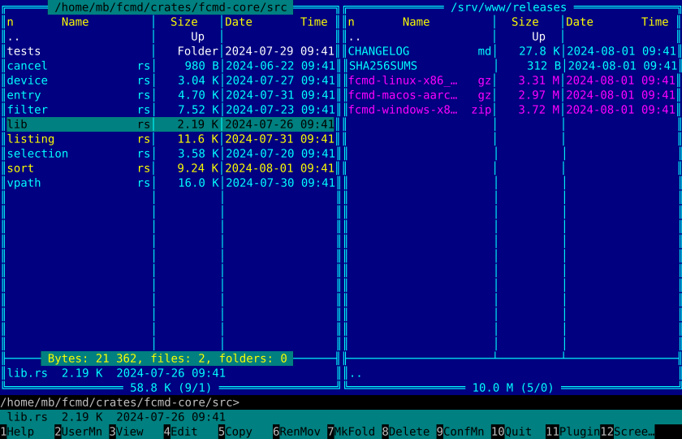
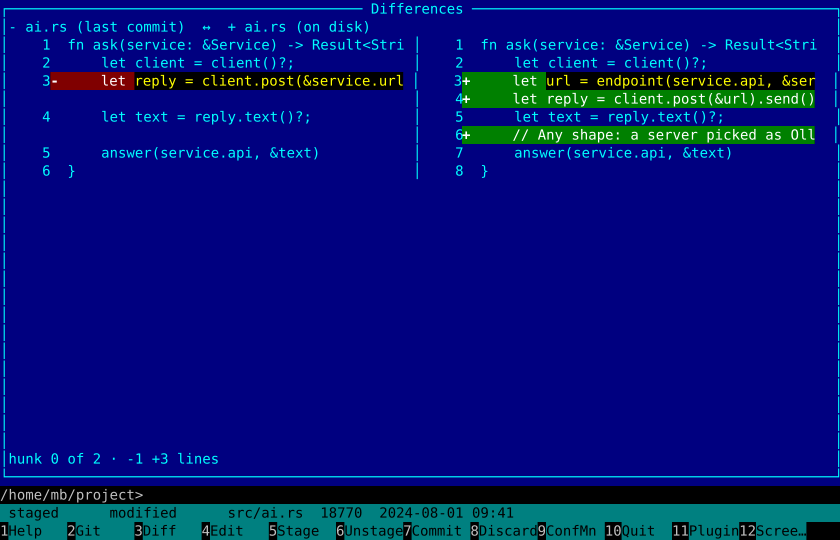
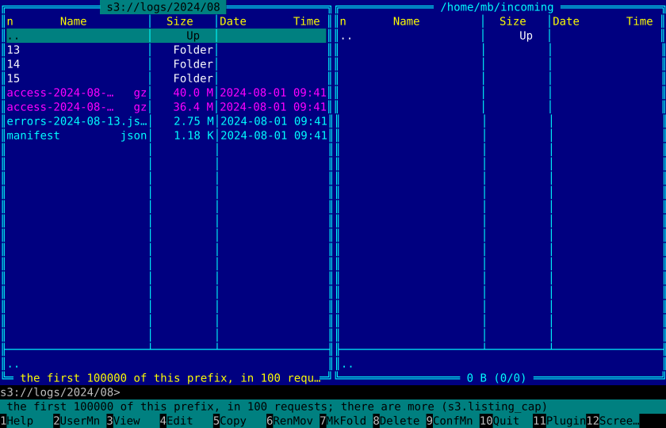
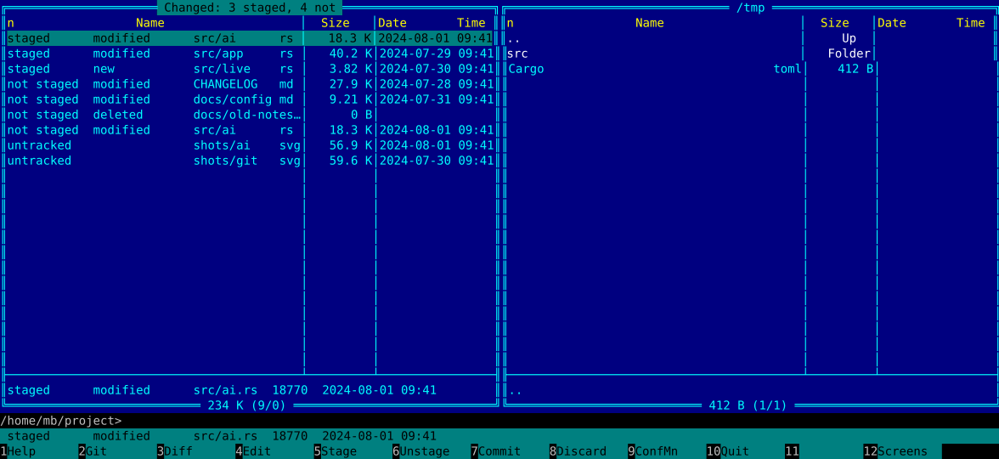

<!-- _class: lead -->
<!-- _paginate: false -->

# FinalCommander

La forma che **Norton Commander** ha dato al terminale
e i tasti che **FAR** ha conservato,
in **un solo eseguibile**.

`fcmd` · versione 0.47.0 · licenza MIT

---

# Perché nasce

- **FAR Manager** è il modello, ma esiste solo per Windows
- **far2l** e **Midnight Commander** sono GPL
- Ogni commander rimasto è legato a un sistema: la stessa idea, rifatta una volta per piattaforma
- Chi cambia computer cambia programma, tasti e abitudini

## L'obiettivo

I tasti e l'aspetto di FAR **ovunque**, con licenza **MIT**,
in **un file solo** e senza niente da installare.

---

# Che cos'è, in un'immagine



<span class="piccolo">Due pannelli, una riga di comando sotto, i tasti funzione in basso. Tutto da tastiera.</span>

---

# Pannelli e operazioni sui file

- **Due pannelli**: da una parte l'origine, dall'altra la destinazione
- Copia `F5`, sposta `F6`, nuova cartella `F7`, elimina `F8`
- Schede, filtri, ordinamenti, ricerca rapida
- Sotto i pannelli c'è la **shell** vera: `Ctrl+O` la mostra

## Sicuro per scelta

- Una copia interrotta **riprende** da dove si era fermata
- Può **verificarsi** da sola con SHA-256
- Un file troppo grande per la destinazione viene rifiutato prima di partire

---

<!-- _footer: "" -->

# Guardare, modificare, confrontare



- **Visualizzatore** `F3`: un log da 40 GB si apre subito
- **Editor** `F4`: colori della sintassi, annulla, blocchi a colonna
- **Esadecimale**: si leggono e si correggono i singoli byte
- **Confronto** fianco a fianco: rosso ciò che è sparito, verde ciò che è arrivato
- Anche immagini, tabelle CSV e database SQLite

---

# Gli archivi sono cartelle

- `Invio` su un archivio e ci si entra, **come in una cartella**
- zip, 7z, tar con tutte le sue compressioni, deb, rpm, cab
- rar, iso e wim attraverso il `7z` già presente sulla macchina
- `F3` legge un file dentro l'archivio, `F5` lo copia fuori
- Si creano, si estraggono e si **verificano** con un tasto

<span class="piccolo">Lo stesso vale per la posta (mbox, eml, msg) e per i database SQLite: ogni tabella è un file.</span>

---

<!-- _footer: "" -->

# Ogni server è un pannello



- **SFTP** e semplici accessi SSH
- **FTP** e FTPS
- **WebDAV**
- **S3** e i servizi compatibili
- Caselle di posta **IMAP**, in sola lettura

Copiare tra due server è un normale `F5`.
Un file remoto si modifica con `F4` e si salva con `F2`.

---

<!-- _footer: "" -->

# Gli attrezzi



- **Cerca** per nome e per contenuto, e sostituisce
- **Confronta e sincronizza** due cartelle
- **Checksum**: MD5, SHA-1, SHA-256
- Trova i **file duplicati**
- **Git** in un pannello
- Elenco di **processi**, **socket** e servizi
- **Pannello AI**: una domanda sui file scelti, e niente parte senza conferma

---

# Dove gira

| Sistema | Su cosa |
| --- | --- |
| **Windows** | Windows 10 e 11, 64 bit |
| **Linux** | PC e server x86-64, anche statico; vecchi PC a 32 bit |
| **Linux ARM** | Raspberry Pi e server ARM, 64 e 32 bit |
| **Linux MIPS** | router con OpenWrt, anche in versione compatta |
| **macOS** | Intel e Apple Silicon, un file per entrambi |
| **Android** | app con il suo terminale, oppure dentro Termux |
| **Browser** | la pagina di prova: Linux in una scheda |

È sempre **lo stesso programma**, con le stesse funzioni e gli stessi tasti.

---

# Confronto: i commander letti

Per la 0.41.0 la domanda era: *facciamo tutto quello che fanno gli altri?*
Sono stati letti gli elenchi di funzioni dei programmi stessi.

- **Ortodossi**: FAR Manager, far2l, Midnight Commander, Double Commander, Total Commander, Krusader, muCommander
- **Da terminale**: nnn, ranger, lf, yazi, broot, vifm, superfile, xplr
- **Chiusi**: Directory Opus, TheFile.Ninja, Commander One

| | Gruppi di funzioni | Coperti |
| --- | ---: | ---: |
| Tutti i 18 programmi | 1038 | **72%** |
| I sette ortodossi | 657 | **74%** |

---

# Confronto: che cosa vuol dire 72–74%

- La risposta onesta è **no: circa tre quarti**
- Si contano *gruppi* di funzioni, a mano: precisione di cinque punti
- Ciò che solo una finestra grafica può fare resta fuori dal conto
- Il quarto che manca sono **le stesse poche cose**, ripetute in molti programmi

## Che cosa hanno gli altri e qui manca

- Taglia, copia e incolla di file, anche con gli appunti del desktop
- Miniature e colonne affiancate con anteprima
- Google Drive, Dropbox, OneDrive
- Etichette e voti sui file; controllo ortografico nell'editor

---

# Confronto: che cosa ha in più

| | Sistemi | Come arriva | Server inclusi | AI | Licenza |
| --- | --- | --- | --- | --- | --- |
| FAR Manager | Windows | installer e plugin | con plugin | no | BSD |
| far2l | Linux, macOS | da compilare, o pacchetto | con plugin | no | GPL |
| Midnight Commander | Unix | pacchetto | SFTP, FTP | no | GPL |
| Total Commander | Windows | installer | con plugin | no | chiusa |
| Double Commander | tutti e tre | applicazione grafica | con plugin | no | GPL |
| **FinalCommander** | **tutti e tre** | **un file** | **SFTP, FTP, WebDAV, S3, IMAP** | **sì** | **MIT** |

Archivi, server, editor esadecimale e database non sono plugin da cercare: **sono già dentro**.

---

# Benefici

- **Un eseguibile**: si copia e si avvia
- **Nessuna dipendenza**: niente installer, runtime o librerie
- **Gli stessi tasti** su ogni sistema: si impara una volta
- **Licenza MIT**: libero e gratuito
- **Funziona via SSH**: è un programma da terminale
- **Senza rete**: aiuto, manuale, temi e quindici lingue sono nel file
- **Macchine piccole**: Raspberry Pi e router, da circa 13 MB

---

<!-- _class: lead -->
<!-- _paginate: false -->

# Provalo

Scarica la versione per la tua macchina:
**github.com/matteobaccan/FinalCommander/releases**

Oppure, su Linux, macOS e Termux, una riga:

```sh
curl -fsSL https://github.com/matteobaccan/FinalCommander/releases/latest/download/install.sh | sh
```

Poi si scrive `fcmd`.
